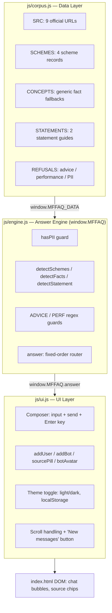

# System Architecture: INDmoney Mutual Fund FAQ Assistant

**Project Code**: PROJECT-INDMONEY-MF-FAQ
**Target Architecture**: Deterministic Retrieval Chatbot, Client-Side Only (no backend, no build step)

---

## 1. High-Level Architecture

The assistant runs entirely in the browser as static files — no server, no API keys, no database. It is deliberately a **three-layer** architecture where each layer only reads from the layer below it, so content, logic, and presentation can change independently.



`index.html` contains **markup only**. It loads `css/styles.css` for all presentation, then the three scripts in dependency order: `js/corpus.js` → `js/engine.js` → `js/ui.js`. Each later script reads from a `window` global exposed by the one before it (`window.MFFAQ_DATA`, then `window.MFFAQ`) rather than sharing implicit scope — the data layer and the engine can each be opened and edited (or unit tested from a console) without touching the others.

---

## 2. Layer Specifications

### Layer 1 — `js/corpus.js` (Data)
The single source of truth for content. Exposes `window.MFFAQ_DATA`:
- **`SRC`** — 9 canonical official URLs (AMC scheme pages, CAMS, KFintech-equivalent, AMFI, SEBI).
- **`SCHEMES`** — the 4 in-scope schemes, each with `name`, `cat`, `bench`, `minsip`, `src`.
- **`CONCEPTS`** — generic educational answers used when a fact is asked without naming a scheme (e.g. "what is an exit load?").
- **`STATEMENTS`** — the two statement-download guides (capital gains, consolidated account statement).
- **`REFUSALS`** — the three canned refusal payloads (advice, performance, PII), each pre-bound to an educational source.

Adding a new scheme or fact type means editing **only this file**.

### Layer 2 — `js/engine.js` (Answer Engine)
Exposes `window.MFFAQ = { answer, fact, detectScheme, detectSchemes, detectFacts, hasPII, LAST_UPDATED }`, wrapped in an IIFE so none of its internal regexes or helper functions leak into the global scope.

- **`fact(scheme, type)`** — generates the canned ≤3-sentence answer + citation for one scheme × fact pair (9 fact types handled via `switch`).
- **`hasPII(text)`** — 6 regex checks (PAN, Aadhaar, email, phone, 11–18 digit account/folio numbers, the literal word "OTP").
- **`detectSchemes(text)`** — returns an *array* of matched scheme ids (not just the first), so a two-scheme comparison can be detected.
- **`detectFacts(text)`** — returns an ordered, de-duplicated array of matched fact ids, so a multi-fact question gets every fact answered, not just the first.
- **`detectStatement(text)`** — separated from fact detection because "capital gains **tax**" (a tax-calculation question) must *not* be mis-routed to "download your capital-gains **statement**".
- **`answer(raw)`** — the router. See §3 for the fixed routing order.

### Layer 3 — `js/ui.js` (UI)
Pure DOM rendering and event wiring; contains zero business logic. Reads answers via `window.MFFAQ.answer(text)` only.

- **Composer**: debounced `ask()` (300ms guard against double-submit), Enter-to-send, suggestion chips that call `ask()` with a canned query and hide themselves after first use.
- **Rendering**: `addUser` / `addBot` build a `.msg` row with an avatar (bot only, recolored amber for refusals), a `.bubble-col` (bubble + timestamp), and — for bot messages with a source — a `sourcePill()` chip plus a "Last updated from sources" stamp.
- **Typing indicator**: a synthetic 450ms delay (`showTyping` → `hideTyping` → `addBot`) so replies don't feel instantaneous for an otherwise-synchronous engine.
- **Scroll handling**: `addUser`/`addBot` always scroll to the newest message (every bot reply is a direct response to the user's own just-sent message, so this is always correct — see [EdgeCases.md §UI](EdgeCases.md)); a separate `scroll` listener on `#chat` independently shows/hides a "New messages" jump button purely based on live scroll position, decoupled from message timing.
- **Theme**: single toggle button, persisted to `localStorage`, CSS custom properties swapped via `data-theme` attribute on `<html>`.

---

## 3. Routing Order (the core design decision)

`answer()` checks conditions in a **fixed order, first match wins**. This ordering is itself the main safety mechanism — a risky query is caught before any fact can be emitted:

```
1. Empty input          → prompt
2. hasPII(t)             → PII refusal                 (checked before anything else)
3. 2+ schemes + vs/compare/better → comparison refusal
4. ADVICE regex          → advice refusal
5. PERF regex            → performance refusal
6. detectStatement(t)     → capital-gains / CAS statement guide
7. scheme + facts.length>=2 → multi-fact composed answer
8. scheme + facts.length==1 → single fact answer
9. scheme, no fact        → "which fact?" clarifying prompt
10. fact, no scheme        → CONCEPTS generic answer, or "which scheme?" prompt
11. neither                → generic help prompt
```

PII is checked **before** scheme/fact detection runs at all — a message containing a PAN number never reaches the fact-lookup code path, regardless of what else it asks.

---

## 4. Data Flow Example

Input: `"exit load and lock-in of HDFC ELSS Tax Saver"`

```json
{
  "schemes": ["elss"],
  "facts": ["exit_load", "lock_in"],
  "routing": "step 7 — scheme + facts.length >= 2 → multi-fact composition",
  "response": {
    "multi": [
      { "a": "HDFC ELSS Tax Saver does not levy an exit load...", "src": "https://www.hdfcfund.com/.../hdfc-elss-tax-saver/direct", "srcLabel": "Official scheme page" },
      { "a": "HDFC ELSS Tax Saver has a statutory lock-in of 3 years...", "src": "https://www.hdfcfund.com/.../hdfc-elss-tax-saver/direct", "srcLabel": "Official scheme page" }
    ],
    "src": "https://www.hdfcfund.com/.../hdfc-elss-tax-saver/direct",
    "srcLabel": "Official scheme page"
  }
}
```

The UI de-duplicates sources across `multi` entries (both facts cite the same scheme page here) before rendering chips, so the user sees one citation, not two identical ones.

---

## 5. Deployment Architecture

No build step, no server, no environment variables, no secrets.

```
Browser ── GET index.html, css/styles.css, js/*.js ── GitHub Pages / any static host
```

`index.html` can also be opened directly via `file://` for local use, though the recommended path for development is a static file server (e.g. `npx serve .`) so relative script/style paths resolve consistently across browsers.
