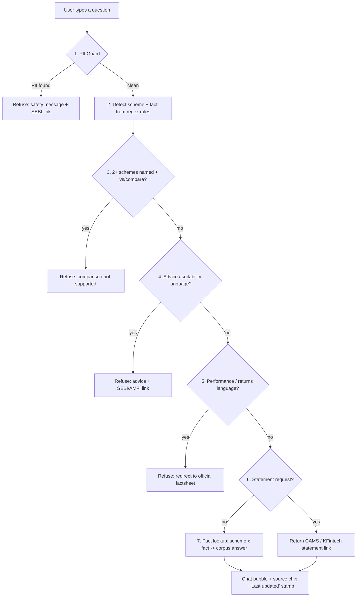

# PROJECT TITLE: INDmoney Mutual Fund FAQ Assistant (Facts-Only RAG Chatbot)

**PROJECT CODE**: PROJECT-INDMONEY-MF-FAQ
**DOCUMENT VERSION**: 1.0.0
**TARGET ARCHITECTURE**: Deterministic Retrieval Chatbot (Client-Side, 3-Layer JS)
**LIP MILESTONE**: *"Mutual Fund FAQs (Facts-Only Q&A)"* — Chosen product: **INDmoney**

---

## 1. EXECUTIVE SUMMARY & THE PROBLEM

Mutual fund investors ask the same handful of factual questions over and over — exit load, lock-in, minimum SIP, benchmark, riskometer, how to download a capital-gains statement — but the real answers live scattered across AMC scheme pages, registrar portals (CAMS / KFintech), and regulator sites (AMFI / SEBI). Answering these with a general-purpose LLM introduces three risks:

1. **Hallucinated facts**: a model may state a TER or exit-load figure that was never checked against an official source. Research for this project found third-party sites disagreeing by **0.58%–1.46%** on the TER of the same fund.
2. **Drift into advice**: "should I buy X" or "which fund is better" are suitability questions, not facts — a facts-only assistant must refuse them, not answer them diplomatically.
3. **PII exposure**: investors naturally paste PAN, folio, or account numbers when asking about statements. A facts-only assistant must detect and refuse this before it is ever processed, not just promise not to "store" it.

## 2. MISSION STATEMENT & OBJECTIVES

Build a small, citation-first FAQ assistant for INDmoney's users, scoped to four HDFC Mutual Fund schemes, that:

- **Guarantees traceability**: every factual answer cites exactly one pre-verified official URL.
- **Eliminates hallucination**: uses deterministic keyword/intent matching over a hand-verified corpus instead of free-form generation for facts.
- **Refuses advice & comparisons**: "is it good", "best fund", "X vs Y" → polite refusal + SEBI/AMFI educational link, never a suitability opinion.
- **Refuses performance questions**: returns, CAGR, "how much will I earn" → redirect to the official factsheet, never a computed or guessed number.
- **Refuses PII**: PAN, Aadhaar, phone, email, account/folio numbers, OTP → detected and refused before any other routing happens.

---

## 3. END-TO-END SYSTEM FLOW



---

## 4. DEEP-DIVE: WHAT THE ASSISTANT COVERS

### Scope
**Product / theme:** INDmoney · **AMC for the corpus:** HDFC Mutual Fund

| Scheme | Category | Benchmark | Min SIP | Exit load | Lock-in |
|---|---|---|---|---|---|
| HDFC Large Cap Fund (ex–Top 100) | Large Cap | NIFTY 100 TRI | ₹100 | 1% < 1 yr | None |
| HDFC Flexi Cap Fund | Flexi Cap | NIFTY 500 TRI | ₹100 | 1% < 1 yr | None |
| HDFC Mid Cap Fund (ex–Mid-Cap Opportunities) | Mid Cap | NIFTY Midcap 150 TRI | ₹100 | 1% < 1 yr | None |
| HDFC ELSS Tax Saver | ELSS | NIFTY 500 TRI | ₹500 | Nil | 3 yrs (statutory) |

### Fact types (8)
Expense ratio (TER), exit load, entry load, minimum SIP, lock-in, riskometer, benchmark, category — plus two statement guides (capital-gains statement, consolidated account statement).

### Sources (22)
AMC scheme pages (hdfcfund.com), the SEBI-registered registrars CAMS and KFintech, MF Central, AMFI, SEBI — full list in [`data/sources.csv`](../data/sources.csv).

---

## 5. WHY DETERMINISTIC MATCHING, NOT EMBEDDINGS / LLM GENERATION

For a corpus this small (4 schemes × 8 fact types = 32 answer slots), keyword/intent regex matching over a hand-verified JSON corpus gives **100% deterministic, auditable retrieval** — the citation can never be wrong because every answer is pre-bound to its source URL at authoring time, not retrieved at query time. An embeddings/LLM-generation pipeline would add latency, API cost, and non-zero hallucination risk for a problem that doesn't need semantic generalization at this scale. This trade-off is documented, not hidden — see [EdgeCases.md](EdgeCases.md) and the README's "Known limits" section.

---

## 6. EXPECTED OUTPUT FORMAT

Every engine response (`window.MFFAQ.answer(text)`) is a small object:

```js
{
  a: "<answer text, <=3 sentences, plain active voice>",
  src: "<one official URL>",
  srcLabel: "<human-readable source name>",
  refuse: true   // present only on advice / performance / PII / comparison refusals
}
```

A multi-fact question (e.g. *"exit load and lock-in of HDFC ELSS"*) returns an additional `multi` array — one entry per fact, each with its own citation — rendered as separate paragraphs in a single chat bubble with de-duplicated source chips.
